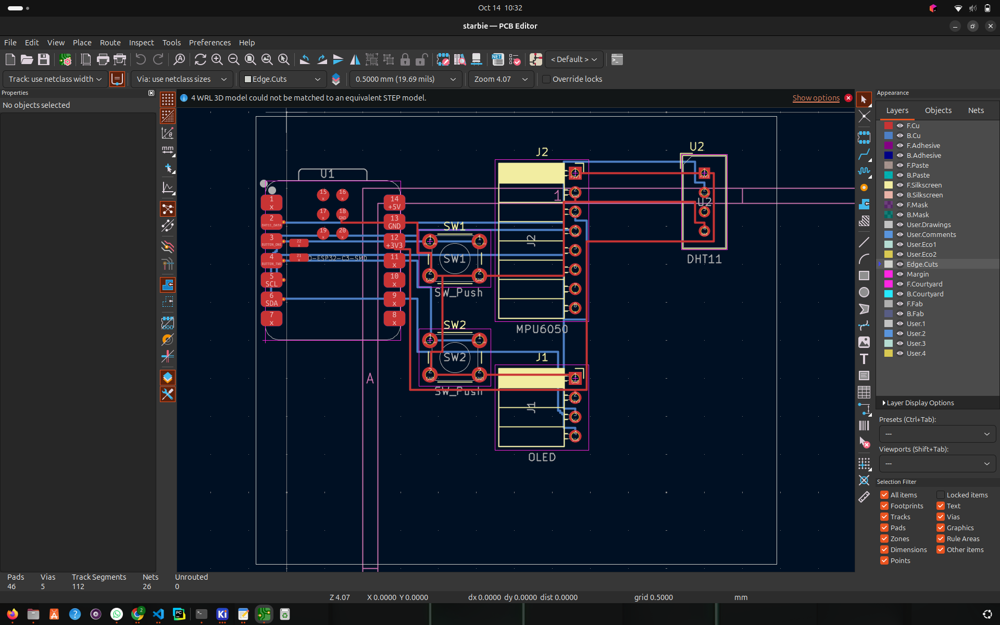

# Starbie 🐾

A tiny motion-controlled digital pet built around the Seeed Studio XIAO ESP32-C3. Starbie uses a small OLED face, two buttons, an MPU6050 motion sensor, and an optional DHT11 environment sensor.

## What it does

- Displays a little animated pet on a 128×64 OLED.
- Uses the MPU6050 to steer a four-choice menu by tilting the board.
- Uses two buttons to open/select the menu and show or hide stats.
- Includes NAP, PLAY, FEED, and PET actions.
- Saves the pet's joy, energy, and fullness between restarts.
- Reads temperature and humidity when a DHT11 is fitted.

## Hardware

- Seeed Studio XIAO ESP32-C3
- 0.96-inch I²C OLED (SSD1306, 128×64)
- MPU6050 module
- Two momentary push buttons
- DHT11 sensor (optional)
- Custom PCB and connecting headers

## Pin mapping

| Function | XIAO pin | ESP32-C3 GPIO |
|---|---|---:|
| OLED + MPU6050 SDA | D5 | 7 |
| OLED + MPU6050 SCL | D4 | 6 |
| DHT11 data | D1 | 3 |
| Button 1 | D2 | 4 |
| Button 2 | D3 | 5 |

The OLED and MPU6050 share the I²C bus. Confirm module pin order and the final schematic before powering hardware.

## Firmware

The Arduino sketch is in [Firmware/Starbie/Starbie.ino](Firmware/Starbie/Starbie.ino).

Install the ESP32 board package and these Arduino libraries:
- Adafruit GFX Library
- Adafruit SSD1306
- Adafruit MPU6050
- DHT sensor library

Select **XIAO_ESP32C3** as the board in Arduino IDE.

## PCB design status

The KiCad schematic and PCB source files are included in this repository:

- [PCB layout](starbie.kicad_pcb)
- [Schematic](starbie.kicad_sch)
- [KiCad project settings](starbie.kicad_pro)

The board is routed. The latest KiCad DRC reports zero unconnected items and zero schematic parity issues, with one U1 local footprint library mismatch warning. The board is not confirmed fabrication-ready, so manufacturing outputs are not included.

## CAD enclosure

The Week 2 parametric Starbie Shell model is in [cad/starbie_shell.scad](cad/starbie_shell.scad), with assumptions and verification notes in [cad/README.md](cad/README.md). The final OpenSCAD exports are [cad/exports/starbie_shell_base.stl](cad/exports/starbie_shell_base.stl) (73.5 × 64 × 18 mm) and [cad/exports/starbie_shell_lid.stl](cad/exports/starbie_shell_lid.stl) (77.8 × 68.3 × 8 mm). OpenSCAD export and mesh inspection found each STL to be one connected, closed mesh. These checks do not verify component clearance, physical fit, strength, or printability; connector and control openings also remain unverified.

### PCB photo

A genuine KiCad PCB Editor screenshot should be added here after capturing the board in PCB Editor. No PCB screenshot is included yet.

## Project log

See [JOURNAL.md](JOURNAL.md) for the project planning entry and [BOM.md](BOM.md) for the parts-funding record.

## Credits

Starbie is based on the Week 1 guide and starter firmware from [SharKingStudios/Starbie](https://github.com/SharKingStudios/Starbie). This repository records my own build progress and future hardware changes.
## PCB Design

